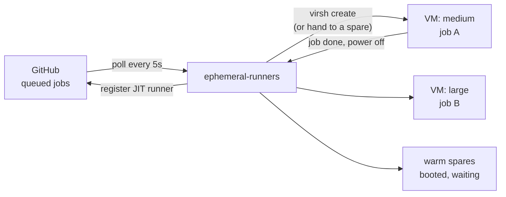

# ephemeral-runners

**Self-hosted GitHub Actions runners where every job gets a fresh KVM VM, sized for that job, destroyed when it ends.**

ephemeral-runners is a single Go binary that runs as a systemd service on a
Linux host with KVM. It watches your repos for queued jobs, registers a
single-use just-in-time (JIT) runner for each one, and hands it to a VM of the
size the job asked for. Warm spares keep the wait short. When the job finishes
the VM powers off and its files are deleted.

```yaml
jobs:
  build:
    runs-on: [self-hosted, linux, x64, example, large]
```

That job gets its own 8 vCPU, 8 GiB VM, booted from an image you build and
rebuild weekly on the host.

## Why

A long-lived self-hosted runner keeps whatever the last job left behind:
caches, credentials, stray processes, a half-upgraded toolchain. Jobs start to
depend on that state, and one job can read another's. GitHub's answer for
self-hosted runners is to make them ephemeral, but something has to start and
tear down a clean machine for every job.

The usual way to do that is
[Actions Runner Controller](https://github.com/actions/actions-runner-controller),
which needs Kubernetes and gives each job a container, not a kernel. This
project is for the case where you have one decent Linux box and want each job
in a real VM with root, its own kernel and no path to the next job, without
running a cluster.

## Status

Working, and covered by tests (about 92% of statements). No releases are
tagged; `main` is the only supported version. Config field names can still
change before a tagged release.

It is built for a handful of repos on one host. Several hosts can serve the
same repo, each with its own `name_prefix`, but they don't coordinate: each
starts a VM for every queued job it sees, and the VMs that lose the race sit
idle until `timeouts.idle`.

## How it works



1. Every `poll_interval` the service lists queued jobs in each configured repo
   and works out the size each job asked for.
2. For each job no waiting runner will take, it registers a single-use runner
   with GitHub and gives its config to a VM of that size: a warm spare if one
   fits, otherwise a new VM.
3. The VM boots from a shared base image through a copy-on-write overlay,
   reads its runner config from a small attached disk, runs the job, and
   powers off.
4. The service deletes the powered-off VM's files and its runner, and keeps
   the configured number of spares booted while jobs keep arriving.

Jobs start oldest first while all of its VMs, spares included, fit in a CPU
and memory `budget`; spares make way for jobs. More detail is in [What the service does](#what-the-service-does).

## Install

The service runs under systemd as its own user, `ephemeral-runners`, which is
the only user that can read the GitHub App key.

**Prerequisites.** A Linux host with KVM (`/dev/kvm` exists), libvirt with the
`qemu:///system` connection and a network for the VMs, `libguestfs-tools` and
`qemu-utils` for the image build, and Go 1.26 or later. On Debian:

```sh
sudo apt install libvirt-daemon-system libvirt-clients qemu-system-x86 \
  qemu-utils ovmf libguestfs-tools golang
```

**Keep VMs off the host and your LAN.** Each VM's network port is isolated,
so VMs on the same bridge or libvirt network can't reach each other. They can
still reach the host and your LAN: on the default `network:default`, libvirt
routes VM traffic through the host, so a job can connect to anything the host
listens on (SSH, exporters) and to every device on your network.
[`examples/nftables-vm-isolation.nft`](examples/nftables-vm-isolation.nft)
blocks that. It lets VMs reach the host only for DHCP and DNS, and blocks
traffic to private, link-local and CGNAT addresses. It adds its own table and
leaves libvirt's alone. Set `vm_bridge` at the top if your network's bridge is
not `virbr0`, add any exceptions you need (and your LAN's prefix, if it has
global IPv6 addresses and the VM network has IPv6), then load it:

```sh
sudo nft -f examples/nftables-vm-isolation.nft
```

To load it at boot on Debian, copy it into a new `/etc/nftables.d/`, add
`include "/etc/nftables.d/*.nft"` to the end of `/etc/nftables.conf`, and run
`sudo systemctl enable nftables`. Debian's `nftables.conf` starts with
`flush ruleset`, so reloading `nftables.service` while libvirt is running
also removes libvirt's rules; reload just this file with `nft -f` instead.

To check it, from a VM, try a port you know is open on the host's bridge
address (`192.168.122.1` on `network:default`), such as SSH with `nc -zv -w5
192.168.122.1 22`, and on a LAN device: both should time out. A refusal
doesn't count, as that means nothing was listening. `curl
https://github.com` should work. The example is for a routed network; a
`bridge:<name>` that puts VMs straight onto your LAN bypasses it, so put such
a bridge on a network that only reaches the internet.

**Give VM disks their own filesystem.** Each VM's overlay in `vm.state_dir`
can grow to the image's disk size (`DISK_SIZE`, 40G by default), and the
budget doesn't count disk. So a job can fill the filesystem `vm.state_dir` is
on. Mount a filesystem or LV of its own at `/var/lib/ephemeral-runners/vms`,
sized for the worst case: the most VMs the budget holds at once (spares
included) × `DISK_SIZE`. With the defaults that is 12 small VMs × 40G = 480G;
most jobs use far less. If you mount it after step 1, run `sudo
systemd-tmpfiles --create` to give it the right owner again.

**1. Install the program.** From a checkout, build the binary as a normal user
(or cross-compile it elsewhere), then install it as root:

```sh
CGO_ENABLED=0 go build -trimpath -o ephemeral-runners ./cmd/ephemeral-runners
sudo deploy/install.sh ./ephemeral-runners
```

This installs the binary to `/usr/local/bin/ephemeral-runners`. (Without an
argument, `install.sh` builds with the `go` on root's PATH.) It also installs
the systemd units, creates the `ephemeral-runners` user (in the `libvirt`
group) and creates these directories:

| Path | Owner | Mode | Holds |
| --- | --- | --- | --- |
| `/etc/ephemeral-runners` | `root:ephemeral-runners` | 0750 | config, key |
| `/var/lib/ephemeral-runners` | `root` | 0755 | images |
| `/var/lib/ephemeral-runners/vms` | `ephemeral-runners` | 0755 | per-VM state |

It does not write the config or start the service.

**2. Create the GitHub App.** Create an App, install it on the repos the
runners will serve, and give it these repository permissions: Actions (read),
Administration (read and write) and Metadata (read). Note the App ID and the
installation ID, and generate a private key.

**3. Install the key.** It must be readable by the service user and nobody
else:

```sh
sudo install -m 0440 -o root -g ephemeral-runners app.pem /etc/ephemeral-runners/app.pem
```

**4. Write the config.** Copy [`examples/config.json`](examples/config.json) to
`/etc/ephemeral-runners/config.json` and edit it (see
[Configuration](#configuration)). Then check it as the service user, which can
read the key:

```sh
sudo -u ephemeral-runners ephemeral-runners check
```

`check` tests the GitHub App setup end to end, minting and deleting a runner,
without starting any VMs.

**5. Build the image.** See [Image](#image). The config's `vm.image` points at
the result.

**6. Start the service.**

```sh
sudo systemctl enable --now ephemeral-runners
journalctl -u ephemeral-runners -f
```

Restarting or stopping the service destroys its VMs and deletes their runners.
This can take up to two minutes, and a job running at the time fails.

To update: pull, build again, run `sudo deploy/install.sh ./ephemeral-runners`
and restart the service.

## Using the runners

Ask for the labels from the config plus one size:

```yaml
jobs:
  test:
    runs-on: [self-hosted, linux, x64, example, medium]
```

Give every job an explicit size label (one of the names in `sizes`). A job
with no size label gets `default_size` from this service, but GitHub may hand
it to a runner of any size that is already waiting.

Inside the VM the `runner` user has passwordless sudo, as on GitHub's hosted
runners. Nothing in the VM survives the job.

## Configuration

`/etc/ephemeral-runners/config.json`. Fields you leave out keep their defaults;
unknown fields are an error. [`examples/config.json`](examples/config.json) has
every field.

| Field | Default | What it does |
| --- | --- | --- |
| `github.app_id`, `github.installation_id` | none | The GitHub App and its installation. |
| `github.private_key_file` | none | The App's private key. |
| `github.api_url` | `https://api.github.com` | Change for GitHub Enterprise Server. |
| `repos` | none | `owner/name` of each repo to serve. |
| `labels` | none | Labels every runner carries, besides its size. |
| `name_prefix` | none | Start of every VM and runner name. Lower-case letters, digits and hyphens. |
| `poll_interval` | `5s` | How often to look for queued jobs. |
| `sizes` | `small` 2/2, `medium` 4/4, `large` 8/8 | VM shapes: `vcpus` and `memory_gib`. Names are letters, digits, `.`, `_` and `-`. |
| `default_size` | `medium` | Size for a job with no size label. |
| `budget` | 24 vCPU, 28 GiB | Total size of all VMs, spares included. Spares are destroyed to make room for jobs. |
| `spares.size`, `spares.count` | `medium`, 4 | Warm spares kept booted. |
| `spares.idle_after` | `20m` | Destroy spares after this long with no jobs. |
| `vm.image` | `/var/lib/ephemeral-runners/images/current.qcow2` | Base image. |
| `vm.state_dir` | `/var/lib/ephemeral-runners/vms` | Per-VM overlays and runner configs. |
| `vm.network` | `network:default` | libvirt network or bridge for the VMs. |
| `vm.libvirt_uri` | `qemu:///system` | libvirt connection. |
| `timeouts.online` | `3m` | Destroy a VM whose runner isn't online by then. |
| `timeouts.idle` | `10m` | Destroy a VM whose runner is online but hasn't taken a job. |
| `timeouts.job` | `6h` | Destroy a VM that has had its job this long. |
| `metrics_file` | empty | Prometheus textfile to write. Empty writes nothing. |

Two hosts must never share a `name_prefix` on the same repo: at start-up the
service deletes every runner whose name starts with `<name_prefix>-`. For the
same reason, prefixes on one repo must not start with each other, as `example`
and `example-x` do.

The VM's memory size is a ceiling: the host only backs pages the guest
touches, and a virtio balloon with free page reporting hands freed pages back
while the job runs. Page cache still counts as in use, so set
`budget.memory_gib` a few GiB below the host's memory.

### Metrics

With `metrics_file` set, the service writes these for node_exporter's textfile
collector every tick:

| Metric | Type | Meaning |
| --- | --- | --- |
| `ephemeral_runners_vms{state,size}` | gauge | VMs by state and size. |
| `ephemeral_runners_spares` | gauge | Warm spares waiting for a job. |
| `ephemeral_runners_jobs_started_total` | counter | Runner configs handed to VMs. |
| `ephemeral_runners_launch_failures_total` | counter | Failed attempts to start a VM or hand it a job. |
| `ephemeral_runners_last_poll_success_seconds` | gauge | Unix time of the last poll where every repo answered. |

The unit makes the file system read-only for the service, except
`/var/lib/ephemeral-runners`. Give it write access to the metrics directory
with a drop-in (`sudo systemctl edit ephemeral-runners`):

```ini
[Service]
ReadWritePaths=/var/lib/node_exporter/textfile
```

The directory must also be writable by the `ephemeral-runners` user.

## Image

`image/build.sh` builds the VM image. Run it as root on the host:

```sh
sudo image/build.sh [config]
```

The config defaults to `/etc/ephemeral-runners/image.env`; see
[`examples/image.env`](examples/image.env) for the settings. Without one, the
build adds no extra packages and no Rust.

It:

1. downloads the Debian 13 genericcloud build pinned in `image/versions.env`
   and checks its SHA-512;
2. downloads the Actions runner, and `rustup-init` if the config lists Rust
   toolchains, at the versions in `image/versions.env`, and checks their
   SHA-256;
3. upgrades the packages, installs the base tools and the config's extra
   packages, removes cloud-init and the SSH server, and installs the Rust
   toolchains and targets from the config;
4. writes `runner-<timestamp>.qcow2` to `OUT_DIR`, points `current.qcow2` at
   it, and keeps the newest `KEEP_IMAGES`.

To pick up a new runner or rustup release, change the version and checksum in
`image/versions.env` together. To move to a newer Debian image, pick a dated
directory under <https://cloud.debian.org/images/cloud/trixie/> and take the
version and hash from its `SHA512SUMS` line.

`deploy/install.sh` also installs a copy of `image/` in
`/usr/local/lib/ephemeral-runners/image` and a timer that rebuilds the image
there once a week. That picks up Debian's security updates through `apt`, but
the base image itself only changes when you bump its pin. Turn it on with
`systemctl enable --now ephemeral-runners-image.timer`. The service replaces
its warm spares once a new image is current. Set `METRICS_FILE` in
`image.env` to record each build's outcome:
`ephemeral_runners_image_build_last_success_seconds` and
`ephemeral_runners_image_build_last_exit_code`.

## How a VM gets its job

The VM runs `actions-runner.service` at boot. It reads a JIT runner config from
a small raw disk with serial `jitconfig`, then runs `run.sh --jitconfig` as the
`runner` user. When the job finishes, the VM powers off.

The host either attaches the disk when it starts the VM, or starts the VM
without it and hot-plugs the disk later. Until the disk appears the VM waits,
for as long as it takes, which is how a booted VM waits as a warm spare. The
service writes its progress to the serial console: `RUNNER-WAIT` once if the
disk was not there at boot, and `RUNNER-START` when it reads the config.

## What the service does

The systemd unit runs `ephemeral-runners run -config /etc/ephemeral-runners/config.json`.
Every `poll_interval`, the service:

1. forgets VMs that have powered off: it deletes their files and their runners
   on GitHub, and retries any runner deletes that failed earlier;
2. lists the queued jobs in each repo whose labels are all in `labels` or are
   a size name. A job without a size label gets `default_size`. Jobs in runs
   that are already in progress are checked every 30 seconds instead, since
   each check costs API requests;
3. checks the runners it started that have not taken a job yet, and destroys
   any VM whose runner is not online within `timeouts.online`, is online
   without a job for `timeouts.idle`, or has had its job for longer than
   `timeouts.job`;
4. for each queued job that no starting or idle runner of its repo and size
   will take, registers a single-use runner named
   `<name_prefix>-<repo>-<size>-<4 hex>` with `labels` and the size, and gives
   its config to a VM of that size: a warm spare if the job is of the spare
   size and one is free, otherwise a new VM. Jobs start oldest first while the
   sizes of all its VMs, spares included, fit in the `budget`; spares are
   destroyed if a new VM needs their room;
5. while jobs have been seen within `spares.idle_after`, keeps `spares.count`
   spares booted (`<name_prefix>-spare-<4 hex>`) and replaces any that booted
   from an older image. After that, it destroys them;
6. writes the metrics to `metrics_file`, if set.

**When GitHub fails.** If one repo's request fails (say the App lost access to
it), the service logs it, skips that repo for the tick and carries on with the
others. Time limits and spare clean-up still run. A VM whose repo couldn't be
checked is only held to `timeouts.job` until the check works again, so a runner
that has just taken a job isn't killed by mistake. After a failed tick it waits
5 seconds, doubling up to a minute.

If GitHub rate-limits it, it stops calling GitHub for the rest of the tick and
waits as long as `Retry-After` asks, or until the limit resets, or a minute
for a secondary limit that says neither. Running VMs carry on meanwhile.

**On start**, it destroys every VM whose name starts with `<name_prefix>-`,
deletes their files from `vm.state_dir`, and deletes that prefix's runners in
each repo; deletes that fail are retried every tick. GitHub refuses to delete
a runner it still shows running a job: the job fails once GitHub notices the
runner has gone, and GitHub then removes the runner itself. The job can be
re-run.

**On SIGINT or SIGTERM**, it stops launching, destroys its VMs, deletes their
runners and files, and exits. A runner that was running a job is left to
GitHub, as on start.

## Development

```sh
go build ./...
go test -race ./...
go vet ./...
golangci-lint run ./...
```

The tests run offline: GitHub is an `httptest` server and libvirt is a fake
command runner. `internal/vm/integration_test.go` drives real VMs and needs
root, KVM and a network; it only runs with `-tags integration`. CI runs gofmt,
vet, the race-enabled tests, golangci-lint and shellcheck on every pull
request.

Commits follow [Conventional Commits](https://www.conventionalcommits.org/).
Renovate keeps dependencies and the pinned actions current.

## Security

A job can run any code it likes inside its VM, with root through `sudo`. The
VM is the boundary. Jobs can't reach each other and nothing in a VM survives
its job, but each VM can reach whatever its network can reach (see
[Install](#install) for keeping VMs off the host and your LAN). The GitHub App
key stays on the host, readable only by the service user; a VM only ever gets
the JIT config for its own runner.

**Check libvirt's security driver.** Every VM's QEMU process runs as the same
user, so only libvirt's security driver keeps one VM's QEMU away from another
VM's files. On the host, `virsh capabilities | grep -A2 secmodel` should list
`apparmor` (or `selinux`). Also check that `grep '^stdio_handler'
/etc/libvirt/qemu.conf` shows nothing or `"logd"`: then virtlogd writes each
VM's serial log and caps its size. If it shows `"file"`, a job can fill the
disk through its serial console.

**Be careful with public repos.** On a public repo anyone can open a pull
request from a fork, and its workflow can ask for your runners' labels. GitHub
[advises against](https://docs.github.com/en/actions/hosting-your-own-runners/managing-self-hosted-runners/about-self-hosted-runners#self-hosted-runner-security)
self-hosted runners on public repos for this reason. If you install the App on
one, at least set fork pull request workflows to require approval for all
outside contributors (Settings → Actions → General), and keep the VMs' network
away from your LAN.

To report a vulnerability, see [SECURITY.md](.github/SECURITY.md).

## Licence

MIT — see [LICENSE](LICENSE).
